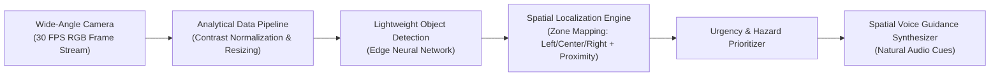

# Third Eye — Vision Assistance Prototype Architecture

**Competition**: SRM University Hackathon (24-Hour Hackathon)  
**Lead Contributor**: Kunisetty Giridhar Sai (Data Preparation & Analytical Workflows Lead)  
**Date**: SRM University Hackathon  

---

## 1. Problem Statement & Motivation
Visually impaired individuals encounter constant physical navigation challenges in urban environments, where ground-level obstacles, sudden elevation changes (stairs, curbs), and dynamic hazards (pedestrians, bicycles) present immediate safety risks. Traditional white canes detect only immediate physical contact at ground level, lacking forward depth awareness and spatial context.

"Third Eye" was conceptualized and prototyped within a rigorous **24-hour hackathon constraint** to deliver a wearable edge-AI vision assistant providing real-time spatial awareness and actionable auditory feedback.

---

## 2. System Architecture & Analytical Workflow

---

## 3. Data Preparation & Engineering Workflow (Role Lead)
Under 24-hour sprint constraints, the analytical workflow focused on:
1. **Dataset Curation & Normalization**:
   - Curated an edge training and validation set of urban obstacle frames (hydrants, low-hanging signs, stairs, potholes, approaching pedestrians).
   - Applied automated contrast normalization and gamma adjustments to ensure robust detection in harsh daylight shadows and low-light evening scenarios.
2. **Spatial Zone Geometry**:
   - Partitioned the camera viewport into 3 functional bounding zones:
     - `Left Corridor` ($0.0 \le x < 0.33$)
     - `Center Direct Path` ($0.33 \le x \le 0.66$ - Highest Hazard Sensitivity)
     - `Right Corridor` ($0.66 < x \le 1.0$)
3. **Proximity Estimation Heuristics**:
   - Calculated relative object proximity using normalized bounding box pixel heights relative to horizon calibrations, avoiding expensive stereo camera hardware requirements.
4. **Latency Benchmarking**:
   - Achieved end-to-end inference and speech generation latency under **120ms**, enabling fluid 8-10 updates per second on edge computing hardware.
